# F1 Data Analysis — Predição de Top 10 na Fórmula 1 e Resiliência sob o Regulamento de 2026

[](https://github.com/VitorAlvs/F1-Data-Analysis/actions/workflows/sync-openf1.yml)


Projeto de **Iniciação Científica (IC)** voltado à predição de classificação na **zona de pontuação da FIA (Top 10)** em Grandes Prêmios de Fórmula 1 utilizando exclusivamente **variáveis pré-corrida**, engenharia de séries temporais concorrentes e comparação empírica entre **modelos clássicos de Machine Learning** e **Redes Neurais Recorrentes (LSTM/GRU)**.

O repositório combina o **ambiente de pesquisa científica** (`notebooks/`) com um **pipeline automatizado de engenharia de dados** (`src/pipeline/` + GitHub Actions) que mantém os datasets atualizados semanalmente via API OpenF1 sob governança *Human-in-the-Loop* (PR automático + suíte de contratos de dados).

---

## Tese e Motivação Científica

A Fórmula 1 moderna é um ambiente orientado a dados, mas historicamente sujeito a quebras estruturais causadas por mudanças de regulamento técnico. O projeto investiga duas perguntas centrais:

1. **Séries Temporais Profundas vs. Modelos Tabulares Clássicos:** A literatura recente aponta limitações de algoritmos clássicos (como Random Forest, Gradient Boosting e SVM) frente ao ruído de meio de pelotão (Sicoie, 2022), enquanto arquiteturas sequenciais (LSTM/GRU) capturam melhor o momento recente de pilotos e equipes (Surendran, 2024). O estudo confronta empiricamente essas abordagens sobre a mesma base pré-corrida.
2. **Resiliência Regulatória em 2026 (*Concept / Data Drift*):** Com a introdução do regulamento de 2026 (unidades de potência 50% elétricas e aerodinâmica ativa), padrões históricos acumulados durante a Era Híbrida anterior são colocados à prova. Modelos treinados em regime estável (`2014–2024`) e testados em `2025` serão submetidos à **validação cega *Out-of-Time* em `2026`** para mensurar a degradação ou resiliência preditiva (Krzysztoń & Smołka, 2025).

---

## Status Atual da Pesquisa

O projeto segue o cronograma oficial da IC e encontra-se na transição entre a **Engenharia de Dados/Features (concluída)** e o **Treinamento/Avaliação dos Modelos (em andamento)**:

- [x] **Revisão Bibliográfica e Alinhamento Metodológico:** Consolidação do estado da arte (8+ artigos de referência) e adoção formal do framework **SPR-CRISP-DM**.
- [x] **Consolidação da Base (Era Híbrida 2014–2026):** Base histórica congelada (`2014–2022`) unificada ao backfill limpo via OpenF1 (`2023–2026`, 91 GPs concluídos até a R21 de 2026, zero duplicatas e 100% de cobertura de `posicao_volta` em 2023–2026).
- [x] **Pipeline Automatizado (CI/CD de Dados):** ETL incremental em Python + GitHub Actions semanal com `pytest` (22 testes) e abertura automática de Pull Request para revisão.
- [x] **Engenharia de Variáveis e Preparação do Treino (`notebooks/F1_IC.ipynb`):** Defasagens (*lags* de 1 a 7), médias móveis isoladas por piloto, alvo `is_top_10`, `One-Hot Encoding`, divisão cronológica (*Time-Based Split*) e escalonamento `MinMaxScaler`.
- [ ] **Em andamento — Treinamento de Baselines Clássicos:** Ajuste e avaliação de *Logistic Regression* e *Random Forest* no conjunto de teste (`2025`) com pós-processamento de ranking por corrida.
- [ ] **Próximo passo — Deep Learning (LSTM / GRU):** Montagem de tensores 3D `(batch_size, 7, features)` no Keras/TensorFlow, avaliação comparativa (F1-Score, Precisão, Recall, Matriz de Confusão) e teste cego *Out-of-Time* na temporada `2026`.
- [ ] **Redação Científica:** Consolidação dos resultados experimentais em artigo para submissão em simpósio acadêmico.

---

## Metodologia Científica (SPR-CRISP-DM)

O desenho experimental adota o framework **SPR-CRISP-DM** (*Sport Result Prediction CRISP-DM*, Bunker & Thabtah, 2019; O'Hanlon, 2022):

1. **Alvo Binário (`is_top_10`):** Classificação binária alinhada à zona de pontuação da FIA (`posicao_final <= 10` → `1`, caso contrário `0`), reduzindo ruído ordinal de meio de pelotão e estabilizando a função de perda (*Binary Crossentropy* + ativação *Sigmoid*) (Krzysztoń & Smołka, 2025).
2. **Isolamento de 24 Séries Temporais Concorrentes:** Como até 24 pilotos competem simultaneamente no mesmo campeonato, *lags* (`1..7`) e médias móveis de janela retrospectiva de **7 corridas** (Surendran, 2024) são calculados estritamente com `groupby("driver_key")` em ordem cronológica `(ano, rodada)` com `.shift(1)`.
3. **Blindagem contra *Data Leakage*:** Variáveis conhecidas apenas durante ou após a corrida (`posicao_final`, `voltas_completadas`, `delta_posicao_grid_final`, `is_overtake`, `diferenca_tempo_segundos`, `fastest_lap_seconds`, `status_final` e agregados de pit stop) nunca entram como atributos diretos da corrida atual — atuam apenas como alvo ou deslocadas no passado.
4. **Isolamento de Granularidade:** Conforme Jafri (2024), a base volta a volta (`vw_voltas_timeseries.csv`) é mantida separada da matriz de nível Grande Prêmio para evitar vazamento intra-corrida e distorções dimensionais.
5. **Particionamento Temporal Estrito (*Time-Based Split*):**
   - **Treino:** `2014–2024` (Era Híbrida estável — Jafri, 2024). `MinMaxScaler` ajustado exclusivamente no treino.
   - **Teste Formal:** Temporada completa de `2025`.
   - **Validação Cega (*Out-of-Time*):** Temporada de `2026` (avaliação de impacto regulatório).
6. **Métricas de Avaliação:** **F1-Score** (métrica primária), Precisão, Recall, Acurácia e Matriz de Confusão.

---

## Pipeline Automatizado de Dados (Python + GitHub Actions)

Os datasets em `data/` combinam o **baseline histórico congelado (`2014–2022`)** com ingestão incremental e idempotente da **API OpenF1 (`2023–presente`)**, executada sem banco de dados local diretamente em runners Ubuntu do GitHub Actions.

```mermaid
flowchart LR
    A["Trigger: Cron Seg 09h BRT ou workflow_dispatch"] --> B["src/pipeline/sync.py<br/>Modo Incremental"]
    B --> C["OpenF1 API v1<br/>Rate Limit: 3 req/s e 28 req/min | Guard: date_end + 2h"]
    C --> D["transformers.py + dob_resolver.py<br/>Padronizacao, Clima, Stints e Posicao por Volta"]
    D --> E["storage.py<br/>Upsert Idempotente, Sort Deterministico e Escrita Atomica"]
    E --> F["Quality Gate<br/>python -m pytest tests/ -v"]
    F -->|"22/22 Passed + Diff"| G["Pull Request Automatico<br/>branch: chore/sync-openf1-data"]
    G --> H["Revisao Humana (HITL)<br/>Merge na main"]
```



### Garantias de Engenharia do Pipeline

* **Incremental e rápido:** Em execuções sem corridas novas (*no-op*), pula temporadas anteriores já completas e evita carregar o CSV de 33 MB desnecessariamente (~4 segundos no runner).
* **Idempotente e atômico:** Reexecutar o sync para o mesmo estado gera hash SHA-256 idêntico nos 3 CSVs; gravações usam arquivo temporário + `os.replace`.
* **Respeito ao Free Tier da OpenF1:** *Rate limiter* de janela deslizante dupla (`<= 3 req/s` e `<= 28 req/min`), *retry* com *exponential backoff* (`429`/`5xx`) e trava `date_end + 2h` para nunca consultar sessões *live* ou incompletas.
* **Governança *Human-in-the-Loop* (HITL):** O bot nunca faz push direto na `main`. Toda atualização só abre PR se a suíte `pytest` (testes unitários + contratos reais de dados) passar integralmente.

---

## Datasets Analíticos (`data/`)

Todos os arquivos seguem contrato físico padronizado: delimitador `;`, encoding `UTF-8` (sem BOM), quebras `LF`, decimal `.`, nulos representados literalmente como `NULL` e ordenação determinística por chave lógica.

| Arquivo (`data/`) | Granularidade | Dimensões Atuais | Tamanho | Uso Principal |
| --- | --- | --- | --- | --- |
| `vw_qualy_features.csv` | 1 linha por piloto/GP (`race_key`, `driver_key`) | 5.543 linhas × 22 colunas | 0,70 MB | Variáveis pré-corrida (grid, tempos `q_best`/`q_worst`/`q_avg`, idade do piloto, clima e contexto do evento). |
| `vw_resultados_com_clima.csv` | 1 linha por piloto/GP (`race_key`, `driver_key`) | 5.543 linhas × 29 colunas | 0,86 MB | Alvo `is_top_10`, resultados finais, ultrapassagens, volta mais rápida e agregados de pit stop para cálculo seguro de *lags*. |
| `vw_voltas_timeseries.csv` | 1 linha por volta/piloto/GP (`race_key`, `driver_key`, `numero_volta`) | 298.947 linhas × 24 colunas | 33,02 MB | Série temporal volta a volta (tempo, posição, composto, idade do pneu e pit) reservada para análises intra-corrida. |

---

## Estrutura do Repositório e Responsabilidades

```text
F1-Data-Analysis/
├── .github/
│   └── workflows/
│       └── sync-openf1.yml             # Automação semanal (cron) e manual (workflow_dispatch) + PR HITL
├── data/
│   ├── vw_qualy_features.csv           # Dataset pré-corrida (qualificação + clima)
│   ├── vw_resultados_com_clima.csv     # Dataset consolidado de resultados, clima e pits
│   └── vw_voltas_timeseries.csv        # Dataset volta a volta (telemetria + pneus + posições)
├── notebooks/
│   └── F1_IC.ipynb                     # Notebook principal da IC (EDA, lags, splits e modelagem)
├── src/
│   └── pipeline/
│       ├── config/
│       │   ├── circuits_map.json       # Mapeamento canônico OpenF1 -> circuit_key (ex.: madring -> madrid)
│       │   ├── climate_thresholds.json # Limiares das flags climáticas (warm >= 25°C, cold <= 18°C, windy >= 25 km/h)
│       │   ├── constructors_map.json   # Unificação histórica de linhagens de equipes (ex.: Sauber/Alfa -> Audi)
│       │   └── drivers_dob.json        # Cadastro de data de nascimento por driver_key para cálculo de idade
│       ├── openf1_client.py            # Cliente HTTP OpenF1 v1 com rate limiter, retries, cache e descoberta de GPs
│       ├── dob_resolver.py             # Resolução de data de nascimento (JSON local + fallback Wikidata/Wikipedia REST)
│       ├── transformers.py             # Funções puras que convertem JSONs da OpenF1 nos 3 DataFrames canônicos
│       ├── storage.py                  # Leitura, upsert idempotente, ordenação determinística e escrita atômica dos CSVs
│       └── sync.py                     # CLI orquestrador do pipeline (incremental, --year, --from-year, --dry-run)
├── tests/
│   ├── test_transformers.py            # Testes unitários determinísticos (clima, idade, grid, laps/position, stints, upsert)
│   └── test_data_contracts.py          # Testes de contrato sobre os 3 CSVs reais (schema, zero duplicatas, invariantes, tamanho)
├── pyproject.toml                      # Configuração do pytest (pythonpath = ["."], testpaths = ["tests"])
├── requirements.txt                    # Dependências mínimas do pipeline e testes (requests, pandas, numpy, pytest)
└── README.md

```

---

## Como Executar Localmente

### 1. Configuração do Ambiente

```bash
git clone [https://github.com/VitorAlvs/F1-Data-Analysis.git](https://github.com/VitorAlvs/F1-Data-Analysis.git)
cd F1-Data-Analysis

python -m venv .venv
# Windows:
.venv\Scripts\activate
# Linux/macOS:
source .venv/bin/activate

pip install -r requirements.txt

```

### 2. Executar o Pipeline de Dados (`src/pipeline/sync.py`)

```bash
# Sincronização incremental padrão (busca apenas novos GPs concluídos)
python -m src.pipeline.sync

# Simulação sem alterar arquivos em data/
python -m src.pipeline.sync --dry-run

# Reprocessar uma temporada específica ou reconstruir a partir de 2023 (com cache local)
python -m src.pipeline.sync --year 2026 --cache-dir .cache/openf1
python -m src.pipeline.sync --from-year 2023 --cache-dir .cache/openf1

```

### 3. Validar Contratos e Testes Automatizados

```bash
python -m pytest tests/ -v

```

### 4. Abrir o Notebook da Pesquisa

Abra `notebooks/F1_IC.ipynb` no VS Code ou Jupyter Lab — os caminhos já apontam de forma relativa para `../data/`.

---

## Principais Referências Bibliográficas

* **Bunker, R. P.; Thabtah, F. (2019); O'Hanlon, E. (2022):** Framework metodológico *SPR-CRISP-DM* aplicado à predição de resultados esportivos e Fórmula 1.
* **Surendran, A. (2024):** Modelagem sequencial com redes **LSTM e GRU** usando janela retrospectiva de 7 corridas e análise de relevância de grid de largada e voltas completadas.
* **Urdhwareshe, A. (2025):** Normalização `MinMaxScaler`, padronização de entidades, indicador de ultrapassagem (`is_overtake`) e redes neurais tabulares (*TabNet*).
* **Sicoie, H. (2022):** Agregação de tempos de qualificação (`q_best`, `q_worst`, `q_avg`), flags climáticas binárias, idade do piloto e limitações de modelos clássicos.
* **Krzysztoń, S. A.; Smołka, J. (2025):** Classificação por faixas de pontuação FIA, avaliação via **F1-Score** e desafio da mudança regulatória de 2026.
* **Jafri, A. (2024):** Fundamentação do recorte da **Era Híbrida (2014+)** e isolamento entre granularidade volta a volta e predição de resultado final.
* **García Tejada, L. (2023); Rao, A. M. (2023):** Estudo de eventos intra-corrida (pit stops) e alerta metodológico contra métricas ingênuas de acurácia sob desbalanceamento.